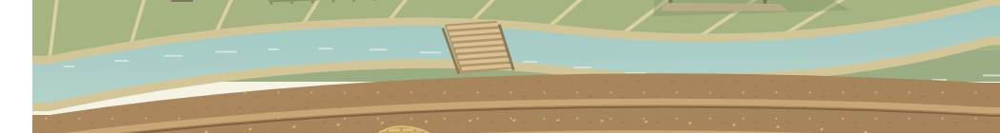
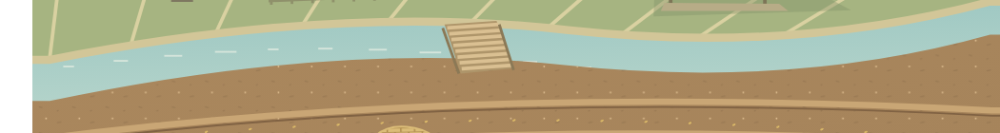

# Landing-edge correction after user screenshot

## Confirmed target: the pale curved band beside the canal

The user clarified that the defect is **inside the illustration, between the canal and soil**. The earlier outer-layout changes below addressed the wrong area. Do not describe those earlier changes as resolution of this band.

The soil's original upper curve did not match the canal's lower curve. That exposed pale background/bank fill. `FIELD_SURFACE` now follows the water contour with a 1.5 SVG-unit overlap to avoid an antialiased seam; the soil fill, texture and field clip share it. The bridge is painted after the soil so its end remains visible. This correction changes no page layout, crop method or farmer records.

Before, captured from the same viewport and crop:

After:

The focused seam regression failed in both browser profiles before this correction. The subsequent **eight affected browser cases passed**, covering the actual water/soil geometry and painted colors, sequential playback, reduced motion and nine-size framing. The seam case also passed a focused desktop/mobile rerun with the desktop explicitly at the reported 1900×860 viewport. Keep the targeted contour test; a test of container padding cannot detect this defect. The final production build, TypeScript, ESLint and formatting checks passed.

## Earlier outer-layout repair (historical, different target)

The earlier completion statement was too broad. It verified the SVG's internal sizing but did not require the surrounding landing layout to have zero gutters. The user's follow-up image showed four columns of pure-white pixels along its left edge. The current landing layout still had 24px outer padding and a 24px column gap.

## Repair

- Remove the landing container's outer padding and column gap. The desktop illustration now meets the top, right and bottom of its panel, directly beside the copy column.
- Keep reading space inside the text/header areas, rather than around the artwork.
- Remove the artwork's rounded outer frame, avoiding exposed white corners around the scene.
- On tall/narrow screens, let the artwork fill the last grid row. Remove the auto margin that created a large empty area above the actions and the unused band under the illustration on tablets.
- Keep proportional SVG framing, one activity at a time and controls below the scene.

## Regression evidence

`tests/e2e/finalization-edge.spec.ts` initially failed on the existing 24px outer padding in both browser profiles. After the repair it passed at 1900×860, 1440×1000, 1024×1366, 412×900 and 320×700, in both desktop and high-density mobile configurations.

The check covers padding/gap, panel alignment, the panel reaching the landing's bottom, and actual painted pixels immediately inside both vertical artwork edges. It uses full-page viewport captures and physical-pixel coordinates derived from the rendered bounds. An element screenshot can include adjacent content when a fractional crop is rounded; that adjacent content must not be mistaken for pixels inside the SVG.

The final focused run passed **four cases**: both new edge checks and both strengthened framing checks. The latter traverse all four chapters at nine sizes. Six playback/reduced-motion/framing cases also passed earlier during this repair. These are focused checks of this change, not a fresh full-site acceptance run. The prior 208-unit/46-browser results remain historical checkpoints.

The optimized production build, strict TypeScript and ESLint passed. An initial sandbox build failed with Windows EPERM while creating generated output after compilation and TypeScript had succeeded; the build with normal filesystem access completed successfully. No production input, crop method, farm record, commit or remote branch was changed by this layout repair.
