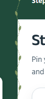
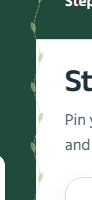
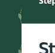
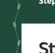
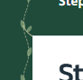

# Main-branch publication check — 26 October 2026

The user requested committing and pushing the accumulated project work and refining the square green junction at the top of the white workspace. The checked-out branch is main and origin is https://github.com/alve775/Ritu.git. A fresh fetch confirmed the local and remote heads matched before staging; no history rewrite is authorized or needed.

## Latest revision: stronger stitch color on white

The user reported that the pale stitch was barely visible on the white workspace. Only the SVG paint changes: use fully opaque olive #82965f for the stem, leaf fill and leaf outline, replacing the pale translucent paints. Paths, stroke widths, dash lengths, 14 × 120px dimensions, position and layering are unchanged. The specified solid color has calculated sRGB contrast of approximately 3.24:1 against white and 3.04:1 against the #204b3b sidebar. These ratios describe the specified paint, not every antialiased edge pixel or a claim of whole-app accessibility.

Primary reference: [W3C non-text contrast guidance](https://www.w3.org/WAI/WCAG22/Understanding/non-text-contrast.html) explains contrast and warns that thin antialiased graphics can appear fainter than their nominal color. This vine is decoration rather than an information-bearing control; the color is chosen for visibility on both backgrounds. No size or stroke-width change is included.

All four focused corner/density browser cases passed, including standard and high-density corner captures. The close-up and full desktop workspace were visually inspected. Evidence: research/audit-2026-10-26/vine-contrast/ and vine-contrast.log. The earlier build and broader test results below belong to their own revisions; this SVG-paint-only update does not rerun them.

## Earlier revision: preserve the whole wavy stitch

The user reported that the wavy stem disappeared after 211e6f5. Moving a background beyond the sidebar's edge clipped its right-hand waves and leaves. The corner-only pixel check passed but did not establish that the full ornament remained visible. Keep the unchanged original 14 × 120px SVG at the same horizontal position and vertical phase, rendered on a fixed decorative sidebar pseudo-element that can paint across the boundary. Do not add a branch, resize or redraw the motif. The layer has pointer-events: none, takes no layout space and disappears with the sidebar on phones and during desktop tours. The square workspace corner and original logo stay unchanged.

All ten focused density/logo/reading browser cases passed. The corrected regression verifies paint on both sides of the corner over a full 120px repeat, not just a single corner pixel. Standard-density capture: 99 left-side and 139 right-side painted pixels; high-density capture: approximately 96 and 117 CSS-pixel equivalents. Close-up, full-shell, native-scrollbar and tour captures were visually reviewed. The narrow ornament now also paints over the outer edge of the scrollbar when present; pointer events pass through to the scrollbar. Both complete desktop tour cases, scoped ESLint, formatting, whitespace checks and the production build including TypeScript passed. Build-generated next-env imports were restored. Evidence: research/audit-2026-10-26/vine-unclipped/, vine-unclipped.log, vine-unclipped-tours.log and vine-unclipped-build.log. These are twelve focused browser cases; the historical complete-suite results below were not rerun for this decorative change.

## Superseded: shifted background clipped the wave

The user explicitly rejected the added branch in d48412e: preserve the original stitch and move it right until its line or leaf intersects the square workspace corner. The extra vine-corner.svg asset is removed. Only the unchanged original public/ornaments/vine-stitch.svg is used, still at 14 × 120px with the same vertical phase. Its horizontal background position moves 7.5px right. The sidebar clips the ornament at its boundary; no branch, extension, resizing or new artwork is added. Logo and control geometry are unchanged.

All ten focused density/logo/reading browser cases passed for this revision. The screenshot-pixel check confirms the unchanged stitch reaches the actual corner on standard and high-density captures, and now also rejects additional artwork or changed motif dimensions. Visual review covers the close-up, full desktop workspace and deliberately visible native scrollbar. Native scrollbars still paint over the decoration. Scoped ESLint, formatting, whitespace checks and the production build including TypeScript passed. Build-generated next-env imports were restored. No app behavior, field data or crop method changes belong to this narrow revision. Evidence: research/audit-2026-10-26/vine-shift-only/, vine-shift-only.log and vine-shift-build.log. The earlier complete unit/browser counts below belong to their original commits.

## Superseded: added connecting branch

The initial vine in b1b9237 left the exact corner green. Commit d48412e added a connecting branch and verified corner paint, but the user rejected that design. The images below are historical comparisons, not the current artwork. Do not restore the connector.

Before and after close-ups, captured at the same CSS size and pixel density:

After the first publication (70b08a2), the user rejected the rounded corner and asked for an agricultural stitch or lotapata motif in the narrow divider instead. The main workspace is square again. A repeating 14 × 120px native SVG vine decorates only the desktop sidebar's right-hand gutter; its dashed stem and alternating leaves use muted sage and straw tones. It replaces the plain inset line.

The pattern is a decorative CSS background: it has no focus target, pointer handler, motion or agronomic meaning. It does not change any control or logo dimensions. Native scrollbars paint over it when scrolling is necessary; the ornament is visible in the otherwise empty gutter. The sidebar and ornament remain hidden in phone navigation and active desktop tours.

All ten focused browser cases passed: four desktop density/logo checks, four phone/reading checks and both complete desktop tours with and without configured farm inputs. Captures were visually inspected with the ornament visible and with a deliberately visible native scrollbar covering the gutter. CSS formatting, whitespace checks, the production build and TypeScript passed. Build-generated next-env imports were restored to the previous development paths. The preceding 208-unit/66-browser result below belongs to 70b08a2; those entire suites were not rerun for this decorative-only revision.

## Earlier rounded-corner publication

The first publication gave the desktop workspace a 24px upper-left radius and added a subtle inset divider. That visual treatment is superseded by the square-corner vine revision above. The screenshot below records the earlier state.

The logo image, white badge, dimensions, typography, navigation steps and saved data are unchanged by this repair. The visual check includes normal-height navigation without a visible scrollbar and short navigation with a deliberately visible native scrollbar.

## Commit scope

Include the accumulated NASA POWER history, current-weather and location integration; published regional crop calendars; real field records and preservation rules; sourced crop photographs and Leaflet assets/licenses; the sequential two-dimensional farm animation; simplified tours and responsive interface; tests; and research/continuation documentation.

Keep local dependencies, research captures/logs, build output and environment files excluded by the existing ignore rules. Preserve but do not stage the pre-existing unrelated October 14 image and the unused website-logo.png screenshot experiment. The canonical website_logo.jpg remains the visible source logo.

The real-only finalization*.spec.ts acceptance suite replaces the prototype-only sample-data assertions for normal CI. Historical browser specifications remain as history and are documented in tests/e2e/README.md.

## Current validation

- 208 unit/API/data tests passed across 18 test files.
- All 66 current browser acceptance cases passed in one complete run, zero failures, 3.8 minutes. This supersedes the earlier aggregate 66-case accounting in the simplification audit.
- Four additional focused desktop density/logo cases passed, including visible-scrollbar clearance and the updated corner captures.
- Repository ESLint passed. Prettier passed for source, tests and root configuration with the checkout's line endings preserved; Git normalizes text during staging.
- Staged whitespace/error checks passed. A bounded scan found no private-key or common credential patterns in the intended source/documentation/asset paths; this is not a comprehensive security audit.
- Production build and TypeScript verification passed. Build-generated next-env imports were returned to the existing development paths after inspecting the diff.

Local evidence: research/audit-2026-10-26/publish-unit.log, publish-browser.log, publish-format.log, publish-lint.log and publish-build.log. GitHub-hosted CI status is separate from these local results. Interface and software checks do not establish farmer usability or agronomic effectiveness.
