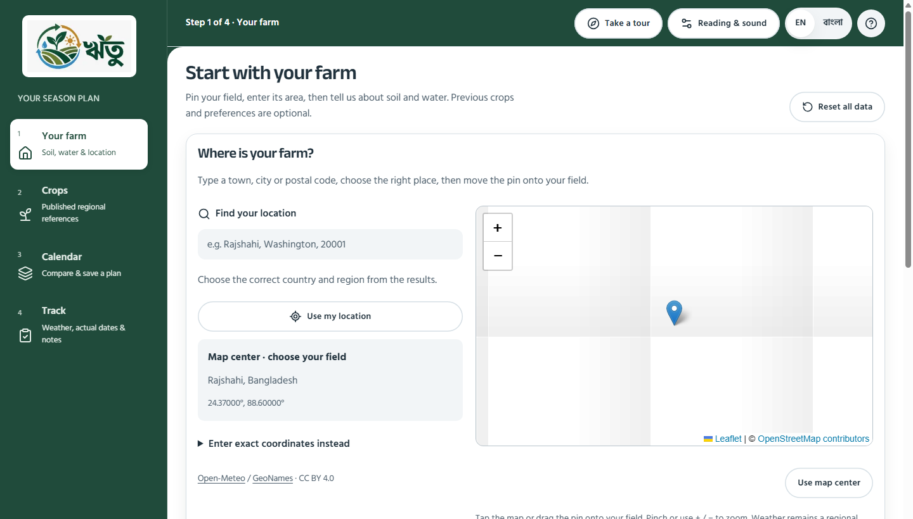

# Main-branch publication check — 26 October 2026

The user requested committing and pushing the accumulated project work and refining the square green junction at the top of the white workspace. The checked-out branch is main and origin is https://github.com/alve775/Ritu.git. A fresh fetch confirmed the local and remote heads matched before staging; no history rewrite is authorized or needed.

## Latest revision: square corner and lotapata divider

After the first publication (70b08a2), the user rejected the rounded corner and asked for an agricultural stitch or lotapata motif in the narrow divider instead. The main workspace is square again. A repeating 14 × 120px native SVG vine decorates only the desktop sidebar's right-hand gutter; its dashed stem and alternating leaves use muted sage and straw tones. It replaces the plain inset line.

The pattern is a decorative CSS background: it has no focus target, pointer handler, motion or agronomic meaning. It does not change any control or logo dimensions. Native scrollbars paint over it when scrolling is necessary; the ornament is visible in the otherwise empty gutter. The sidebar and ornament remain hidden in phone navigation and active desktop tours.

All ten focused browser cases passed: four desktop density/logo checks, four phone/reading checks and both complete desktop tours with and without configured farm inputs. Captures were visually inspected with the ornament visible and with a deliberately visible native scrollbar covering the gutter. CSS formatting, whitespace checks, the production build and TypeScript passed. Build-generated next-env imports were restored to the previous development paths. The preceding 208-unit/66-browser result below belongs to 70b08a2; those entire suites were not rerun for this decorative-only revision.

## Earlier rounded-corner publication

The first publication gave the desktop workspace a 24px upper-left radius and added a subtle inset divider. That visual treatment is superseded by the square-corner vine revision above. The screenshot below records the earlier state.

The logo image, white badge, dimensions, typography, navigation steps and saved data are unchanged by this repair. The visual check includes normal-height navigation without a visible scrollbar and short navigation with a deliberately visible native scrollbar.

## Commit scope

Include the accumulated NASA POWER history, current-weather and location integration; published regional crop calendars; real field records and preservation rules; sourced crop photographs and Leaflet assets/licenses; the sequential two-dimensional farm animation; simplified tours and responsive interface; tests; and research/continuation documentation.

Keep local dependencies, research captures/logs, build output and environment files excluded by the existing ignore rules. Preserve but do not stage the pre-existing unrelated October 14 image and the unused website-logo.png screenshot experiment. The canonical website_logo.jpg remains the visible source logo.

The real-only finalization*.spec.ts acceptance suite replaces the prototype-only sample-data assertions for normal CI. Historical browser specifications remain as history and are documented in tests/e2e/README.md.

## Current validation

- 208 unit/API/data tests passed across 18 test files.
- All 66 current browser acceptance cases passed in one complete run, zero failures, 3.8 minutes. This supersedes the earlier aggregate 66-case accounting in the simplification audit.
- Four additional focused desktop density/logo cases passed, including visible-scrollbar clearance and the updated corner captures.
- Repository ESLint passed. Prettier passed for source, tests and root configuration with the checkout's line endings preserved; Git normalizes text during staging.
- Staged whitespace/error checks passed. A bounded scan found no private-key or common credential patterns in the intended source/documentation/asset paths; this is not a comprehensive security audit.
- Production build and TypeScript verification passed. Build-generated next-env imports were returned to the existing development paths after inspecting the diff.

Local evidence: research/audit-2026-10-26/publish-unit.log, publish-browser.log, publish-format.log, publish-lint.log and publish-build.log. GitHub-hosted CI status is separate from these local results. Interface and software checks do not establish farmer usability or agronomic effectiveness.
