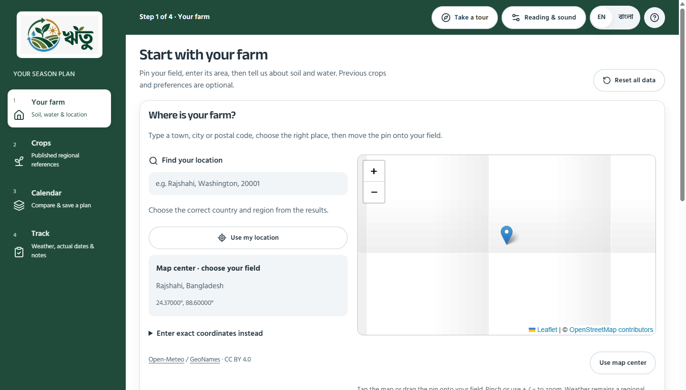
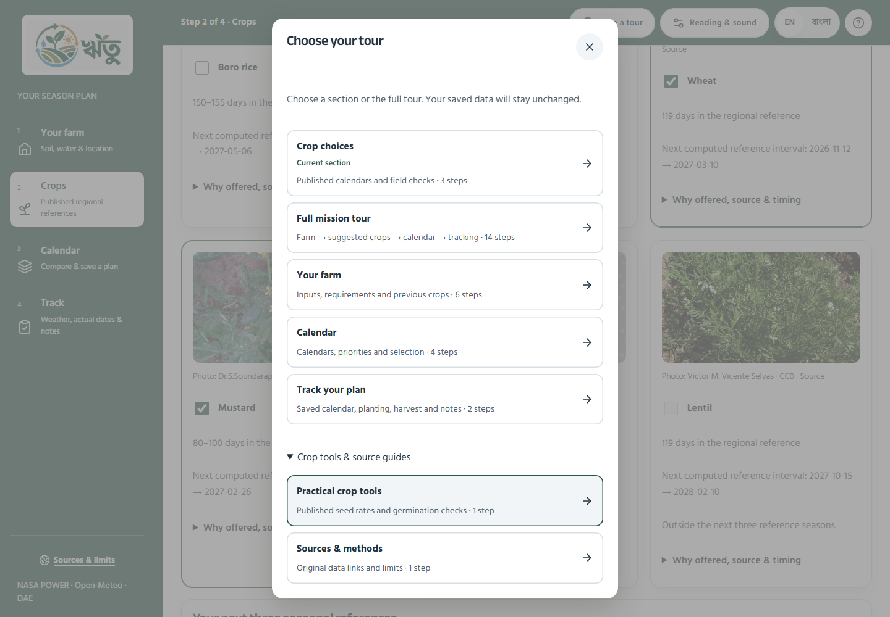

# Necessary simplification, with useful guidance retained

The user preferred the website at 90% browser zoom, then clarified: reduce something only if necessary; otherwise keep it. This audit follows that constraint. It does not treat a shorter tour count, fewer controls or a smaller font as inherently better.

## Current decisions

- Keep the four stages: Your farm → Crops → Calendar → Track. They perform different jobs; none is removed or combined.
- Standard text changes from 18px to 16px using a relative root size of 100%. This approximates the preferred density without forcing browser zoom or applying a transform. Extra large stays 24px, and existing reading preferences remain saved. The source logo, badge dimensions and layout from the preceding repair are unchanged. Existing button/input target sizes are retained.
- The original source contains 19 guide stops, rather than the reported 28. Remove only the repeated “Review before continuing” stop: the page already has an explicit continuation button, exact missing-input errors, reset and export controls.
- Keep 18 distinct explanations overall. The full mission tour includes 14 core stops. Previous crops and preferences remain in the six-stop farm section guide; the crop calculator and source documentation keep their own guides. First-visit onboarding contains five stops: welcome, location, field basics, soil and water.
- Keep separate guidance for leaving a season unplanted, crop selection, conflicting choices, full date intervals, NASA history, saving, current weather and actual records. They explain different actions or evidence limits and are not removed to meet a numerical target.
- The current section appears first in the chooser, and every choice states its actual length. Specialist tool/source guides sit under a clearly named expandable section, which opens initially on the sources page. Main section guides remain directly visible.
- The Track guide now visits weather before actual records, matching the visible page order instead of returning upward.

## Screens audited

Fresh before captures were taken through the existing isolated Playwright setup before editing, at 1440 × 1000 CSS pixels. The six routes below were opened and the saved captures inspected. These use controlled weather fixtures and blanked map tiles; they are interface evidence, not a live-data demonstration.

| Step | Surface | Finding and resulting action |
| --- | --- | --- |
| 1 | Landing | The landing action, language controls and sequential farm animation have distinct purposes. Keep them. Standard text follows the shared size change. |
| 2 | Your farm | Repeated identity/progress text and location explanation consume space. Put the desktop step count in the toolbar and retain the in-page counter on phones. Remove the duplicate location eyebrow and repeated map-center warning from the separate field-basics card. Keep the actual selected/unselected field status and all required inputs. |
| 3 | Crops | Seasonal filters, unplanted choices, source crop photos and conflict explanations are useful. Keep them. The technical week-to-date conversion is optional reading, so move that explanation into an expandable details block; essential regional timing limits stay visible above the choices. |
| 4 | Calendar | Full durations, nursery notes, gaps, NASA provenance, Why this calendar and the save acknowledgement serve different purposes. Keep all of them. |
| 5 | Track | Forecasts, inspection reminders, actual planting/harvest dates, notes and export serve different purposes. Keep them. Fix only the tour order. |
| 6 | Sources | Keep the original links, methods and limits. This page is available on demand rather than appended to every full tour. |

Before evidence: research/audit-2026-10-26/simplification-before. After evidence: research/audit-2026-10-26/simplification-verification and simplification-retained-help.

## Controls that genuinely had no ranking effect

Source review of src/domain/evidence-planner.ts confirms only three priorities have implemented sorting rules: familiar crops, botanical-family diversity and pulse inclusion. Water conservation and drought concern fall through to the ordinary deterministic tie-break and do not change ranking.

Those two priorities are therefore removed from new active choices. If a farm already saved either value, its selection remains visible as a disabled, explicitly unranked previous choice. The saved value and field records are not migrated or discarded. The user can choose one of the three working priorities. Water-access inputs and crop-specific checks remain; this change does not invent a water-saving or drought-resilience score.

Other form inputs remain because they have an identified use: location selects environmental records and regional scope; district confirms reference coverage; area supports published arithmetic; planning start chooses future reference periods; soil/drainage support sourced notes and checks; previous crops support familiarity; household crops and unavailable-help months constrain candidate calendars.

## Research and limits

- [GOV.UK: Structuring forms](https://www.gov.uk/service-manual/design/form-structure) recommends a question protocol: know why an answer is needed and how it is used. This supports removing the two inert ranking choices and retaining inputs with a defined purpose. It does not prove this farm workflow has been validated with farmers.
- [GOV.UK: Details](https://design-system.service.gov.uk/components/details/) recommends expandable help for information only some users need and explicitly cautions against hiding information most users need. Accordingly, only specialist explanations and technical calculation detail are collapsed; primary crop dates, constraints and timing limits stay available in the working flow.
- [W3C: Resize Text](https://www.w3.org/WAI/WCAG22/Understanding/resize-text.html) explains enlarging text to 200% without loss of content or functionality. Smaller default text is a response to the user's visual preference, not a universal scientific optimum. Browser resizing and the larger reading option remain available. Automated checks alone do not establish full WCAG compliance.

The first broad Firecrawl search returned mostly general WAI/WCAG pages, and its targeted summaries omitted relevant sections. The three original pages above were subsequently read as full page content. No recommendation relies on those incomplete summaries or on the attempted W3C short-path URL, which returned 404.

## Verification

**66 distinct browser cases passed across the broad run and focused follow-ups.** This is an aggregate of the runs below, not a claim that a single 66-case command was run. The eight focused density/logo/reading cases also passed before the broad run.

1. The complete initial 62-case run passed 61 cases. One mobile guide-count assertion used the earlier plural string “1 steps” after the UI was corrected to “1 step.” The matching test source is corrected.
2. The retained-help run passed six of eight cases: all section guides, all optional help and the complete 14-step Bangla tour at 320px on both browser projects. It cleared the earlier mobile count failure. Two newly added saved-priority checks exposed test-helper issues: the initial enabled-option query returned no matches; after using an explicit combobox locator, the generic disabled matcher still reported an option with a disabled attribute as enabled. Those helpers now use the combobox role and the native option.disabled property instead of relying on that matcher.
3. Both saved-priority cases then passed. They verify all three active choices, persistence of a working priority after reload, preservation of older water/drought selections, explicit unranked status and preservation of saved field records. No application behavior was weakened to satisfy the tests.

Evidence logs: simplification-browser.log, simplification-help.log, simplification-priority-final. All are under research/audit-2026-10-26. The full mission tour is tested both with and without completed farm setup. Tests also cover accessible routes, unchanged farm inputs, source limits, conflict validation, saving, reset, weather outages, reading preferences, Bangla at narrow widths, section navigation, spotlight/card separation and the sequential landing animation.

The fresh full-page farm capture at 1440 × 1000, using the same entered-farm fixture, decreased from 2610px to 2380px in height (about 8.8%). The preceding empty-farm density checkpoint was 2671px, compared with 2380px after simplification; these are separately seeded captures and are not combined into one before/after claim. The root is 16px, the desktop heading is 32px, the logo remains 180 × 98px, and the desktop header still begins at the 264px sidebar boundary.

Production build and TypeScript passed. Scoped ESLint, formatting and React component review passed. The build log is research/audit-2026-10-26/simplification-build.log. Build-generated next-env imports were restored to their prior development paths. No commit, push, dataset change or farm-data migration was performed.

On narrow screens the tour's text region can scroll inside the instruction panel, preserving room for the highlighted page and fixed tour controls. The 320px checks verify navigation and panel bounds; they do not establish that every paragraph is visible simultaneously, or that every assistive technology has been tested.

Physical farmer/device usability trials, agronomic effectiveness and a universally optimal font or tour length are not established by this audit. No crop-planning rules, data sources or recorded farm observations are removed by the content simplification.

## Continuation checklist

- Preserve all four workflow stages, the existing logo, saved observations and real-data provenance.
- Keep unique explanations even if that increases the tour count. The count follows the information, not the other way around.
- Keep optional guides discoverable. Full tour and first-visit onboarding must not silently populate or modify farm inputs.
- Keep water/drought ranking choices out of new active options until an authentic, implemented method exists; preserve older saved values.
- Keep exact validation, overlap checks, date/forecast distinctions, large-text controls and export/reset protections.
