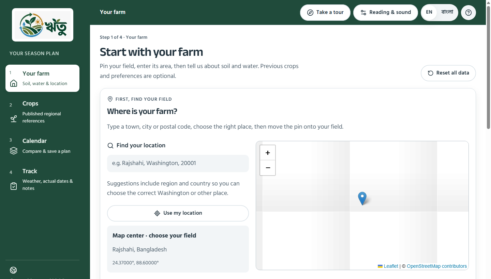

# Compact typography and integrated branding

> Latest follow-up: [SIMPLIFICATION_AUDIT_2026-10-26.md](SIMPLIFICATION_AUDIT_2026-10-26.md) records the user's 90% zoom preference and “reduce only if necessary” constraint. The standard size is now 16px, while the logo and its layout are unchanged. The 18px measurements and 58-case result below describe the preceding checkpoint.

Latest user feedback: centering the badge in the full-width header still looked awkward. Keep the pre-pull white badge and its proportions, but fix the surrounding composition. The logo now belongs to the top of the desktop navigation sidebar, with deliberate space above and below it. The utility header begins at the main-content column. This supersedes the centered-in-header, square-image, cropped-SVG and screenshot-PNG experiments.

## Current implementation

- Default body text is 18px, reduced from 20px. Desktop page headings are 36px, reduced from 44px. Extra large remains 24px and saved reading preferences survive.
- Cards, navigation rows and location controls use tighter spacing. Principal input/button targets retain their existing usable sizes. The location-search icon and label sit on one line.
- The logo source is the unchanged public/website_logo.jpg used by pre-pull commit 773ae1121dd1addfeac81645f42ae55fbea5e0db. The reflog confirms that commit immediately precedes the October 25 fast-forward to 1e4b07c.
- Keep the historical white backing, 8px padding, 10px corner radius, and the historical 2:1 image viewport with object-fit: cover and object-position: 50% 52%. This reproduces the old rendering of the square source image; it is not the later full-square presentation.
- The desktop badge is 180px wide, centered inside the sidebar content area. The sidebar starts at the top of the viewport. It provides 24px above the badge and at least 24px before the section label. A stable native scrollbar gutter keeps the entire badge inside the navigation column without a JavaScript width observer.
- The desktop toolbar starts at the sidebar boundary and aligns its current-section label with the main content. Reading, tour, language and help controls remain on the right. The old header stretched across the sidebar even though the badge was nearly as tall as the header, leaving conspicuous side gaps and almost no vertical clearance.
- Phones and tablets retain one compact header badge with at least 8px clearance around it. Desktop tours show the compact header badge while their navigation sidebar is hidden. Only one home-logo link is visible at a time. The home link retains alternative text and a visible keyboard-focus outline.
- No expanded white strip, SVG crop wrapper, stretched logo or replacement screenshot asset is used. The source JPEG is unchanged.

## Research and design judgment

[Carbon's UI shell guidance](https://www.carbondesignsystem.com/building-blocks/core/components/ui-shell-header/guidelines) treats the header and side navigation as coordinated components, distinguishes product navigation from global utilities, and uses the header to orient the user. [USWDS header guidance](https://designsystem.digital.gov/components/header/) emphasizes recognizable identity, clear navigation and layout chosen to fit the content. These principles support the separation used here; they do not prescribe moving this particular logo or certify its appearance.

The 180px badge, 24px clearance and responsive breakpoints are implementation choices reviewed in actual browser captures. They are not claimed as a scientifically optimal size or evidence of improved farmer performance. A before capture was taken before changing the layout, and the complete desktop composition is inspected rather than assessing an isolated logo crop alone.

## Verification

The complete current finalization suite passed: **58 browser cases, zero failures, 4.4 minutes**, using one worker across desktop and emulated phone projects. The suite includes branding assertions at 320, 390, 768, 1024, 1440 and 1920 CSS pixels, a deliberately visible native scrollbar, saved reading sizes, a narrow Bangla header and both desktop/mobile home links. All existing finalization checks also passed, including full-tour spotlight/card separation with and without a completed farm, automated accessibility scans, navigation, saved calendars, reset and the landing animation. These results cover this configured suite, not every conceivable device or task.

An initial focused run passed five cases and found one outdated test helper that could not measure a deliberately hidden sidebar on phones. The helper now selects visible branding and safely measures hidden layout elements. After that correction, the complete 58-case run above passed. The failure was in the test helper, not a hidden production-sidebar error.

Browser evidence: research/audit-2026-10-26/brand-shell-verification and brand-shell-browser.log. Visual review includes the complete 1440px composition and 390px, 768px and 1024px captures, not only isolated logo crops. The measured desktop badge is 180 × 98px at x=34.5px, y=24px; the toolbar begins at x=264px, matching the sidebar boundary. The scrollbar test measured a real 16px gutter and 24px clearance both above the badge and below it before the section label.

The same desktop capture configuration measured the farm page at 3025px before density changes and 2669px afterward. This is a software-layout measurement, not proof of farmer task performance or a scientifically optimal font size. QA captures use fixture weather and blank map tiles, not live field observations.

Before: the badge nearly filled the header height and floated in its own green strip.

After: the unchanged badge belongs to the desktop navigation column, while the toolbar aligns with the content. Map tiles are blanked by the automated test fixture in this capture; this is layout evidence, not a live-data demonstration.

Production build and TypeScript passed, as did scoped ESLint and formatting for the changed source and browser specification. The build log is research/audit-2026-10-26/brand-shell-build.log. Build-generated next-env imports were returned to their original development paths after verifying the diff. No farm records, recommendation method, source logo JPEG, commit or remote branch was changed for this layout repair. Physical-device and farmer usability testing remain outside this verification.

## Continuation rules

1. Keep the pre-pull JPEG and white rounded badge. Do not replace it with the screenshot PNG, a full-square thumbnail, a new SVG window or a full-width white rectangle.
2. Keep the desktop badge integrated into the sidebar with deliberate vertical clearance and native scrollbar clearance. Keep one compact badge in mobile and tour headers. Do not restore the cramped full-width-header composition.
3. Keep 18px as the default and preserve adjustable reading size unless the user changes that preference.
4. Preserve the separately repaired canal-to-soil contour.

Primary guidance consulted: [W3C text resizing](https://www.w3.org/WAI/WCAG22/Understanding/resize-text.html), [W3C target sizing](https://www.w3.org/WAI/WCAG22/Understanding/target-size-minimum.html), [MDN image fitting](https://developer.mozilla.org/en-US/docs/Web/CSS/Reference/Properties/object-fit), and [MDN scrollbar gutters](https://developer.mozilla.org/en-US/docs/Web/CSS/Reference/Properties/scrollbar-gutter). These do not certify the entire application or establish an optimal font size.
