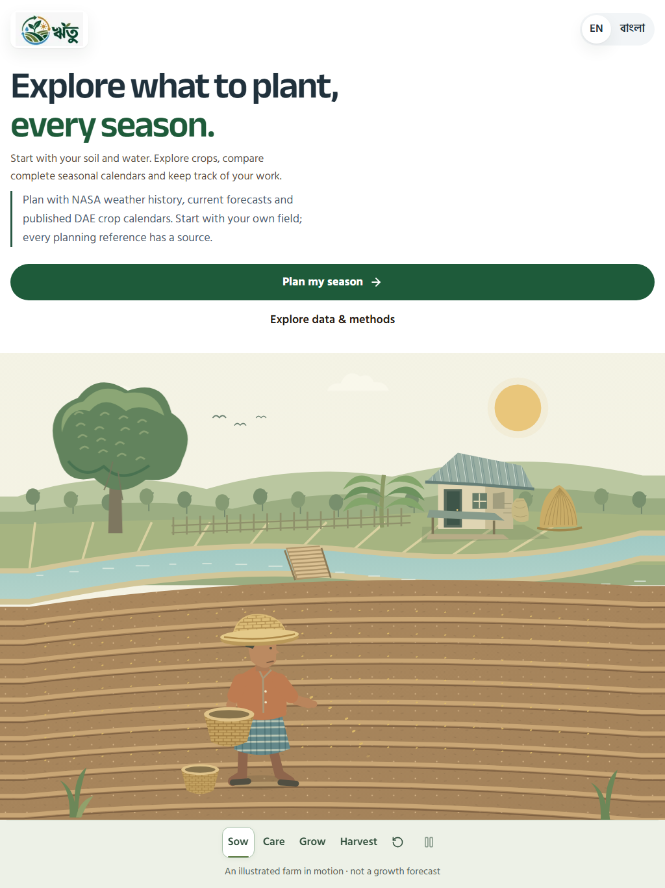
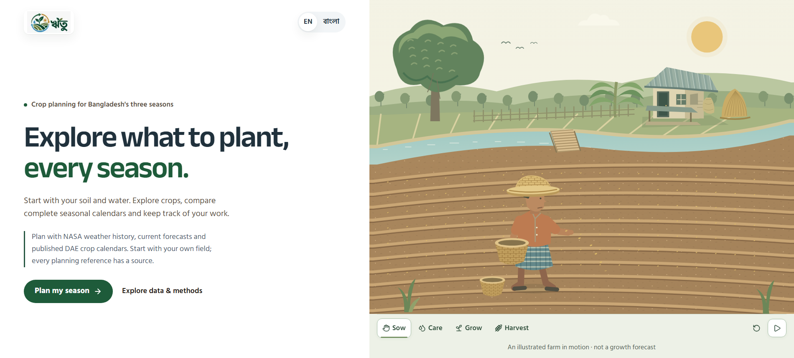
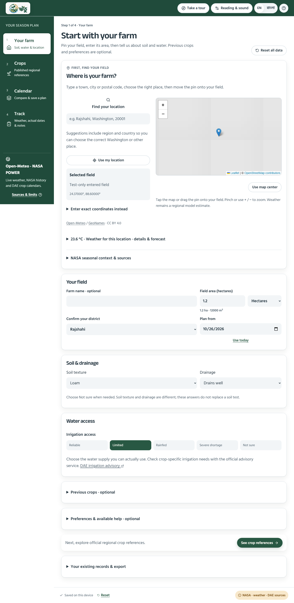
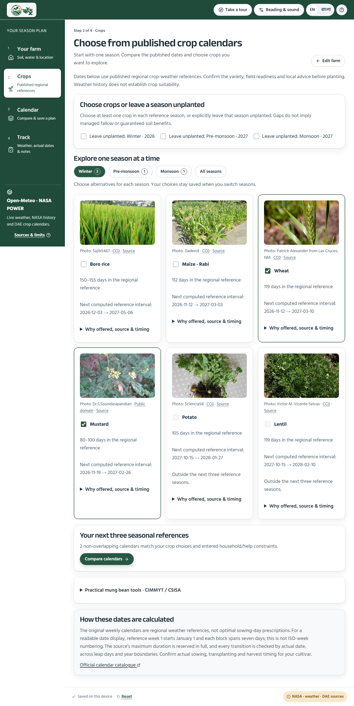
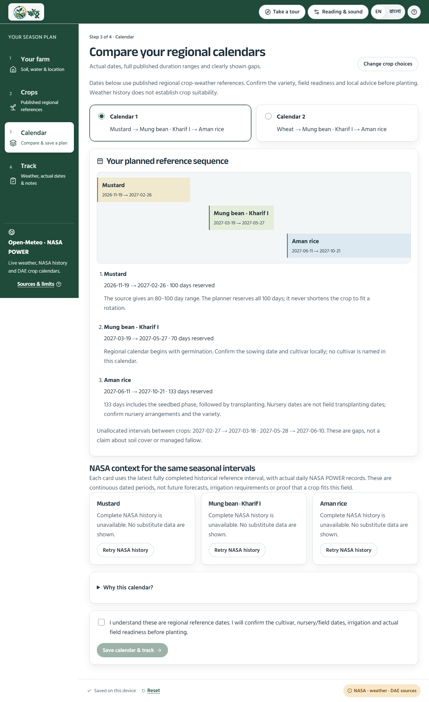
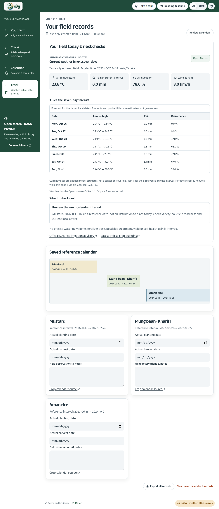
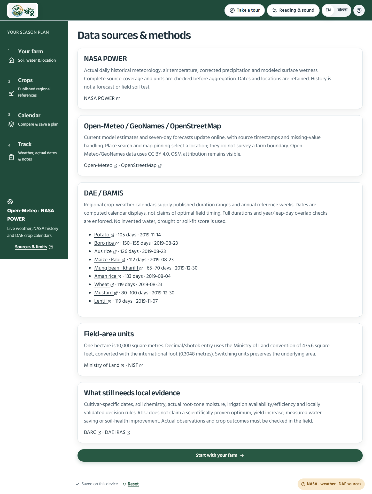

# RITU: usability, evidence and layout audit

Audit date: 26 October 2026. This is the current continuation record, superseding earlier mock-workflow acceptance results. Preserve the detailed sequential **2D** scene and real-only production routes. No new commit, push or deployment was requested.

> Confirmed follow-up target: the pale curved band **between canal and soil**. Earlier outer-gutter changes addressed the wrong area. [EDGE_CORRECTION_2026-10-26.md](EDGE_CORRECTION_2026-10-26.md) now records the corrected shared contour, matching before/after crops and the targeted regression. Earlier passing counts below belong to their stated checkpoints.

## Scope and evidence

The reported pale gutters were reproduced in fresh browser captures. The audit followed the full journey: landing → farm setup → seasonal crop choices → calendar comparison → field records → sources. It also checked direct links, invalid/missing input, saved records, unavailable providers, Bangla, enlarged text, keyboard navigation, sound controls and guided tours.

Fresh before/after screenshots and machine-readable results are in `research/audit-2026-10-26/`. Accepted captures are copied below so this record does not depend on ignored research files. These are **software QA captures**: the harness supplies an explicitly test-only farm profile, recorded weather fixtures and transparent map tiles, and deliberately returns a NASA-history failure for the six-page audit. They are not evidence of live observations, mapped field boundaries or agronomic outcomes. Separate real-provider retrieval checks are recorded in [FINALIZATION_2026-10-26.md](FINALIZATION_2026-10-26.md).

## Journey findings and implemented repairs

| Step                | Reproduced problem                                                                                                                                                                              | Change and current health                                                                                                                                                                                                                                                                                                                                                |
| ------------------- | ----------------------------------------------------------------------------------------------------------------------------------------------------------------------------------------------- | ------------------------------------------------------------------------------------------------------------------------------------------------------------------------------------------------------------------------------------------------------------------------------------------------------------------------------------------------------------------------ |
| 1. Landing          | The SVG's fixed aspect ratio and underfilled paths left strips around the artwork. Portrait framing also clipped background landmarks and could clip the worker in a narrow desktop column.     | **Repaired:** the camera follows the actual frame ratio; sky, land and furrows extend to the edges. Landmarks move within the frame; narrow/tall viewports use one column. Characters retain their proportions. One activity plays at a time; controls remain outside the scene.                                                                                         |
| 2. Your farm        | Weather details dominated the intake; optional sections prolonged it; a sticky Continue bar could obstruct the form. Missing input produced generic guidance. Hectares were the only area unit. | **Repaired:** location → field details → soil/drainage → water access; optional crop history/preferences follow. Weather still loads automatically, with details expandable. Continue stays in document flow. A focused error summary links to each missing control. Area supports hectares, m² and decimal/shotok without changing the saved area when switching units. |
| 3. Crops            | Nine full cards mixed three seasons. A previously selected crop could become disabled and impossible to remove.                                                                                 | **Repaired:** open the next reference season first; keep visible seasonal filters and selected counts. Choices persist across filters. An incompatible saved choice can always be unchecked. Boro is blocked for rainfed-only access using the cited irrigated-crop classification. No invented numeric water requirement is introduced.                                 |
| 4. Calendar         | A disabled action could leave farmers guessing which date, crop or household/help constraint prevented a result. Earlier step numbers also implied completion just by visiting a later page.    | **Repaired:** explain missing seasons, blocked crops, exact overlapping intervals and entered help/household conflicts. Never shorten a published duration to force a result. Completion indicators reflect actual saved state; page headings and document titles say Step N of 4.                                                                                       |
| 5. Track            | A temporarily invalid draft field area could invalidate the whole persisted record on reload. Advisory separators could wrap onto their own lines.                                              | **Repaired:** accept finite draft input in storage and enforce planning limits at review time. Actual saved calendars and notes survive draft edits. Advisory links use a spaced layout. Explicit export, reset and replacement controls remain.                                                                                                                         |
| 6. Help and sources | A source-dialog link could navigate without closing the dialog. First-visit onboarding visited later screens even when setup was incomplete.                                                    | **Repaired:** source navigation closes its dialog. The first visit teaches the farm setup in eight steps and stays there. The explicit 19-step full tour and section replays remain available. Source pages explain actual integrations, dates, licenses, unit conventions and missing evidence.                                                                         |

### Accepted visuals

The wide, shallow frame reproduces the class of composition that exposed the original defect. These captures have been opened and visually inspected; they are not accepted solely because files were generated.

1. Landing: 
2. Farm setup: 
3. Seasonal choices: 
4. Calendar: 
5. Records: 
6. Sources: 

## Research → implementation

These sources justify specific design choices or data constraints. They do **not** establish an experimentally optimal interface, a universal krishibid consultation sequence or proven farmer adoption.

| Primary source                                                                                                                                                                                                     | Supported decision and boundary                                                                                                                                                                                                                                                |
| ------------------------------------------------------------------------------------------------------------------------------------------------------------------------------------------------------------------ | ------------------------------------------------------------------------------------------------------------------------------------------------------------------------------------------------------------------------------------------------------------------------------ |
| [W3C: multi-page forms](https://www.w3.org/WAI/tutorials/forms/multi-page/)                                                                                                                                        | Group related controls, distinguish optional stages and expose progress in page titles. The four product steps and order are our dependency-based design choice, requiring farmer testing.                                                                                     |
| [W3C: input validation](https://www.w3.org/WAI/tutorials/forms/validation/)                                                                                                                                        | Identify required inputs and provide accessible, actionable feedback. Error-summary links focus the relevant control. Server APIs separately validate provider requests.                                                                                                       |
| [W3C: target size](https://www.w3.org/WAI/WCAG22/Understanding/target-size-minimum.html)                                                                                                                           | WCAG's 24 CSS-pixel minimum has exceptions; principal controls use larger targets. A chosen font size or green shade is not a scientifically universal comfort optimum.                                                                                                        |
| [W3C: pause, stop, hide](https://www.w3.org/WAI/WCAG22/Understanding/pause-stop-hide.html)                                                                                                                         | Decorative movement is pausable, with reduced-motion support. Sound is opt-in, adjustable and muteable; synthesized ambience communicates no farming measurement or alert.                                                                                                     |
| [MDN: SVG aspect ratio](https://developer.mozilla.org/en-US/docs/Web/SVG/Reference/Attribute/preserveAspectRatio)                                                                                                  | Avoid letterboxing while keeping uniform scaling. A resize-derived viewBox and edge-covering paths fix this artwork's framing instead of stretching it.                                                                                                                        |
| [FAO: inclusive smallholder digital tools](https://www.fao.org/agroecology/in-action/detail/principles-for-socially-inclusive-digital-tools-for-smallholder-farmers-a-guide/en)                                    | Local language, inclusion and participatory design matter. English/Bangla and clearer tasks support that goal; no farmer interviews or task-success study have yet validated them.                                                                                             |
| [FAO: land-management decisions](https://www.fao.org/land-water/Land/sustainable-land-management/practices-and-decision-making/en)                                                                                 | Local conditions and practical constraints matter. Preserve soil uncertainty, household requirements and water availability; a location pin alone does not establish suitability.                                                                                              |
| [NASA POWER data documentation](https://power.larc.nasa.gov/docs/faqs/data/)                                                                                                                                       | Historical meteorology is derived from assimilation/model sources and has source resolution and latency. Show dates, units and original records; keep it separate from current forecasts and measured field moisture.                                                          |
| [Bangladesh Ministry of Land](https://minland.gov.bd/pages/static-pages/694032ae35ce18e1c0560717), [NIST](https://www.nist.gov/pml/us-surveyfoot/revised-unit-conversion-factors)                                  | Decimal/shotok uses the explicitly stated 435.6 ft² convention, converted with the international foot of 0.3048 m. Thus one decimal is 0.0040468564224 ha. Other inconsistent/local unit conventions on the land page were not imported; no bigha/katha assumption is made.    |
| [FAO/WFP Bangladesh report](https://www.fao.org/4/ai472e/ai472e00.htm), [BAMIS Boro reference](https://www.bamis.gov.bd/crops/view/75)                                                                             | Boro is an irrigated dry-season crop. Use that qualitative classification for rainfed-only access, not the report's historical weather as today's conditions, nor an invented irrigation dose or threshold.                                                                    |
| [DAE/BAMIS calendars](https://www.bamis.gov.bd/en/calendar/), [CIMMYT/CSISA mung guide](https://csisa.org/wp-content/uploads/sites/2/2014/06/Easy-to-use-methods-to-improve-mungbean-production-in-Bangladesh.pdf) | Nine original regional calendars provide published durations/reference weeks; the mung guide supports drainage cautions and named-method seed/germination tools. Source-specific limits remain visible. Regional weekly references do not establish optimal exact sowing days. |

For staging and sequential animation research, see the Disney/Adobe references and shot-by-shot decisions in [FARM_ANIMATION_STORYBOARD.md](FARM_ANIMATION_STORYBOARD.md).

## Method and challenge alignment

The official challenge page retrieved on this date identifies [Field Shift: Adapting Farms with NASA Data](https://www.spaceappschallenge.org/2026/challenges/adapting-farms-with-nasa-data/). Its summary concerns rotation decisions combining NASA Earth observations, local soil/crop information and priorities. RITU's location-based NASA context, source-linked regional rotations, farmer constraints, transparent explanations and records support that direction. The retrieved page provided a summary; recheck the complete technical brief/resources before final submission. Do not infer Rajshahi's exact rubric or a winning score from a different local event or an older year's guidelines.

NASA history currently supplies **environmental context**; it does not establish parcel-specific crop suitability or calculate an optimum rotation. Changing entered constraints recalculates valid reference sequences. There is no fabricated climate perturbation or numeric drought/soil-health ranking. Those omissions are deliberate evidence boundaries, not completed capabilities to advertise.

The planner reserves the **maximum** published source duration and uses half-open day intervals with actual year/leap-day boundaries. A following crop may start on the preceding interval's end date because that date is excluded from the preceding crop; displayed harvest/reference-end dates are the preceding day. Rice nursery time is conservatively included; a separate nursery plot is not assumed. Farmers can explicitly leave a reference season unplanted. Gaps are called unallocated intervals, not asserted soil-rest benefits.

## Verification and remaining work

Historical prototype tests are regression history, not proof of the current planning method. The active browser selection is `finalization*.spec.ts`.

- [x] Full unit/API/asset suite: **208 passed**, 18 files.
- [x] Complete desktop/mobile browser run: **46 passed in one run**. Subsequent stricter artwork checks exposed portrait-tablet clipping, which was repaired; the affected four route/frame cases passed a focused rerun. The final two frame cases also passed with **nine sizes × four chapters × two browser configurations = 72 chapter/frame checks**, including explicit worker, house, tree and sun bounds. These are the same cases strengthened and rerun, not extra distinct passing cases.
- [x] Final ESLint, Prettier (preserving checkout line endings), strict TypeScript and optimized production build passed after the last source changes.
- [x] Compiled-production browser smoke passed on a separate temporary local port: all four chapter controls worked, the new farm remained blank, nine original calendar links were present and no browser page errors occurred. Evidence is `research/audit-2026-10-26/production-smoke.json` and its desktop/phone captures. The temporary server was stopped afterward; the user's dev server was preserved.
- [x] Visually inspect all six desktop routes, mobile intake/crops and the frame at wide, portrait and narrow sizes.
- [x] Check record preservation, area-unit round trips, precise invalid-input focus, seasonal choice persistence, source dialog navigation, sound settings and the setup-only first visit.
- [x] Preserve source durations, no-overlap checks, real-only production inputs, blank initial farm and record exports.
- [x] The six-route audit reported no horizontal document overflow and zero automated axe WCAG A/AA violations on both viewports. This is bounded automated coverage, not full accessibility certification.
- [x] Real-provider requests through the local app returned current Open-Meteo conditions/seven forecast days and a complete NASA POWER mung interval, **2026-03-19–2026-05-27, 70 days**, with original request URL and retrieval timestamp. These responses use the provider cache and retain its actual timestamps. Saved separately as `live-weather.json` and `live-season-history.json` under the audit research folder.
- [ ] Krishibid review of cultivar, nursery/transplant timing and regional applicability.
- [ ] Real farmer task tests in Bangla on low-cost phones, with task success, errors and comprehension measured.
- [ ] Physical-device/screen-reader, deployment/service-limit and backup/recovery acceptance.
- [ ] Field soil chemistry, root-zone moisture, irrigation capacity/efficiency and validated crop-outcome evidence before precise recommendations or claims of yield, water savings or improved soil health.

An automated accessibility scan, software test or attractive illustration cannot close the last four validation items. Current records are stored in the browser; clearing device storage can remove them, so export remains important.

Supplied project-plan and October 14 image SHA-256 hashes were rechecked and remain unchanged. No existing work was reset, and no commit, push or deployment was performed.

## Continuation checklist

1. Read this file, inspect git status/diff and current runtime; preserve supplied artwork and `docs/PROJECT_PLAN.md`.
2. Keep the eight-step automatic setup tour and explicit full/section replays distinct. Do not populate fictional farm inputs to demonstrate locked screens.
3. Test the actual SVG frame and worker/landmark geometry at 1920×650, 1900×860, 1440×1000, 1024×768, 1024×1366, 900×1200, 768×1024, 412×900 and 320×700 after animation/layout changes. Compare fractional rendered dimensions, not rounded integer `clientWidth`/`clientHeight`. Wait for responsive sizing before accepting a screenshot.
4. Never relax source duration/overlap/household checks merely to enable a calendar button. Show the exact blocker and an explicit path to resolve it.
5. Keep draft validity separate from record persistence: a temporary bad area/date must not discard actual saved observations.
6. Update this record with completed checks and remaining limits. Do not reuse historical passing counts or claim bug-free software, proven agronomic effectiveness or contest victory.
